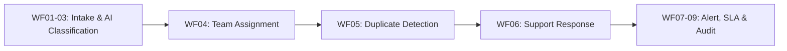

# 📋 Kiến Trúc & Đặc Tả Kỹ Thuật: Workflows 4, 5, 6

**Tác giả:** Trương Thị Mộng Ngân (`mtn81226`)  
**Dự án:** HelpMetaAI - AI-Powered IT HelpDesk Automation Pipeline  
**Hệ thống thực thi:** n8n Workflow Automation Platform & MongoDB Atlas  

---

## 1. Tổng Quan Phân Chia Trách Nhiệm

Trong kiến trúc tổng thể gồm 9 quy trình xử lý ticket tự động, phân hệ **Workflows 4, 5, 6** chịu trách nhiệm xử lý nghiệp vụ trung tâm giữa tầng AI phân loại (WF01 - WF03) và tầng điều phối/giám sát (WF07 - WF09):

Mỗi quy trình được thiết kế với **13 nodes** trực quan, kết hợp linh hoạt giữa các khối:
- 🌐 **Webhook** (`n8n-nodes-base.webhook`): Điểm nhận request độc lập và từ pipeline
- ⚙️ **Code Node** (`n8n-nodes-base.code`): Xử lý logic nghiệp vụ, chuẩn hóa NFD, bóc tách chữ ký
- 🔀 **IF Condition** (`n8n-nodes-base.if`): Rẽ nhánh kiểm tra tính hợp lệ dữ liệu
- ✏️ **SET Variable** (`n8n-nodes-base.set`): Gán tham số cấu hình chính sách (routing, SLA, bảo mật)
- 🌐 **HTTP Request** (`n8n-nodes-base.httpRequest`): Chuyển tiếp sang workflow tiếp theo
- ↩️ **Respond to Webhook** (`n8n-nodes-base.respondToWebhook`): Trả kết quả JSON về cho bên gọi

---

## 2. Đặc Tả Chi Tiết Từng Quy Trình

### 🎯 WF04: Team Assignment & Multi-Tier Escalation
* **Webhook Endpoint:** `POST /webhook/team-assignment`
* **Số lượng nodes:** 13 nodes
* **Nghiệp vụ nâng cao:**
  1. **Định tuyến VIP Khẩn cấp (Executive Fast-track):**
     - Nhận diện các từ khóa nhạy cảm: `vip`, `ban giám đốc`, `hội đồng quản trị`, `phòng họp tổng giám đốc`, `boardroom`, `ceo`, `director`.
     - Phân bổ ngay vào đội chuyên trách: `Executive VIP Support Taskforce`.
     - Hàng đợi độc quyền: `queue-executive-fasttrack`.
  2. **Định tuyến leo thang 2 cấp (Tier 1 vs Tier 2 Escalation):**
     - Mức ưu tiên `Critical` hoặc `High` đối với `Security` chuyển về: `Security Operations (Tier 2 Incident Response)`.
     - Mức ưu tiên `Critical` hoặc `High` đối với `Network` / `Hardware` chuyển về: `Infrastructure Operations (Tier 2)`.
     - Hàng đợi tương ứng có hậu tố `-escalated` (ví dụ: `queue-network-escalated`).
     - Các ticket thông thường (`Low`, `Medium`) vào hàng đợi L1 tiêu chuẩn (`queue-network`, `queue-hardware`, `queue-access`...).

---

### 🔍 WF05: Duplicate Detection & Vietnamese NFD Text Normalization
* **Webhook Endpoint:** `POST /webhook/duplicate-detection`
* **Số lượng nodes:** 13 nodes
* **Nghiệp vụ nâng cao:**
  1. **Chuẩn hóa tiếng Việt NFD:**
     - Tách bỏ dấu thanh âm tiếng Việt bằng giải thuật chuẩn hóa Unicode NFD (`normalize('NFD').replace(/[\u0300-\u036f]/g, '')`).
     - Chuyển `đ` -> `d`, loại bỏ toàn bộ ký tự đặc biệt và dấu câu.
  2. **Từ điển Stopwords chuyên sâu cho IT HelpDesk:**
     - Bộ lọc hơn 50 stopwords thông dụng trong giao tiếp IT nội bộ: `toi`, `la`, `bi`, `khong`, `duoc`, `cho`, `va`, `it`, `oi`, `ad`, `admin`, `help`, `ho`, `minh`, `nho`, `nhanh`, `gap`, `alo`, `em`, `anh`, `chi`, `ticket`...
  3. **Tạo Fingerprint & Signature độc bản:**
     - `duplicateFingerprint`: Kết hợp tiền tố danh mục và danh sách từ khóa cốt lõi đã sắp xếp theo bảng chữ cái: `${category}|${sortedKeywords.join('|')}`.
     - `duplicateSignature`: Chữ ký gọn xác định nhóm sự cố: `${category}#${priority}#${keywords.slice(0, 4).join('-')}`.

---

### 💬 WF06: Support Response Guidance & Security Safeguard
* **Webhook Endpoint:** `POST /webhook/support-response`
* **Số lượng nodes:** 13 nodes
* **Nghiệp vụ nâng cao:**
  1. **Tự động hướng dẫn khắc phục sự cố theo ngữ cảnh (Contextual Triage):**
     - **Họp trực tuyến (Zoom / Teams / Meet):** Hướng dẫn kiểm tra quyền truy cập Microphone/Camera trên hệ điều hành và kiểm tra cổng USB tai nghe.
     - **Phần mềm Kế toán & ERP (MISA / SAP / Fast):** Hướng dẫn xử lý treo tiến trình bằng Task Manager, kiểm tra kết nối SQL Server và thu hẹp bộ lọc xuất báo cáo.
     - **Mạng Wi-Fi văn phòng:** Thao tác "Quên mạng" (Forget Network) và kiểm tra captive portal bằng trình duyệt ẩn danh.
     - **Bảo mật thông tin:** Ưu tiên số 1 ngắt ngay kết nối vật lý (rút dây LAN/tắt Wi-Fi), không nhấp link lạ.
  2. **Cam kết SLA theo mức độ nghiêm trọng:**
     - `Critical`: Phản hồi khẩn cấp 15 - 30 phút.
     - `High`: 1 - 2 giờ làm việc.
     - `Medium`: 4 - 8 giờ làm việc.
     - `Low`: Trong vòng 24 giờ làm việc.
  3. **Chính sách an toàn định danh (Security Credential Policy):**
     - Tự động gắn cảnh báo bắt buộc: *"⚠️ Lưu ý bảo mật: Nhân viên IT tuyệt đối không bao giờ yêu cầu mật khẩu hoặc mã OTP của bạn."*

---

## 3. Bảng Tổng Hợp Kiểm Thử

| Test Suite | Tập Tin | Số Case Kiểm Thử | Trạng Thái |
| :--- | :--- | :---: | :---: |
| **WF04 Team Assignment** | `tests/test-wf04-team-assignment.mjs` | 14 assertions | ✅ 100% PASS |
| **WF05 Duplicate Detection** | `tests/test-wf05-duplicate-detection.mjs` | 20 assertions | ✅ 100% PASS |
| **WF06 Support Response** | `tests/test-wf06-support-response.mjs` | 13 assertions | ✅ 100% PASS |
| **End-to-End Pipeline** | `tests/test-e2e-pipeline.mjs` | 23 assertions | ✅ 100% PASS |
| **Tổng Cộng** | **4 Test Suites** | **70 assertions** | **✅ 100% PASS** |
